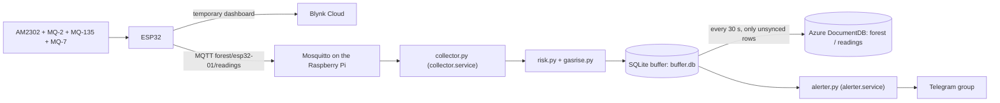

# Forest Fire Early-Warning Node (IoT)

Coursework project for the IoT class at Tecnológico de Monterrey (ITESM). An ESP32 reads temperature, humidity, smoke, air quality and CO in a forest, a Raspberry Pi stores and evaluates the data, and a Telegram bot alerts when fire risk is high.

- **Sensing:** AM2302 (DHT22) + MQ-2 (smoke) + MQ-135 (CO2/VOC) + MQ-7 (CO) on an ESP32.
- **Edge processing:** a Raspberry Pi receives readings over MQTT, scores fire risk and buffers everything in SQLite.
- **Cloud storage:** unsynced readings are uploaded every 30 s to Azure DocumentDB (Cosmos DB for MongoDB vCore).
- **Alerts:** a separate service sends Telegram messages on ALERTA / CRITICO, plus "back to normal" and "no data" notices.
- **No reflashing for tuning:** thresholds, levels, alert rules and sync settings live in `config.json` and apply without a restart. The ESP32 publish interval is changed over MQTT.

---

## Contents

1. [Architecture](#architecture)
2. [Hardware](#hardware)
3. [Repository layout](#repository-layout)
4. [Setup](#setup)
5. [How risk is calculated](#how-risk-is-calculated)
6. [Configuration reference](#configuration-reference)
7. [Useful commands](#useful-commands)
8. [Security notes](#security-notes)
9. [Known limitations and roadmap](#known-limitations-and-roadmap)

---

## Architecture



Design points:

- **Store-and-forward.** Every reading is written to SQLite first. A thread uploads batches and marks rows as synced only after Azure accepts them. Duplicate keys count as success, so retries are safe. If Azure is unreachable, readings wait in SQLite. Synced rows older than 7 days are deleted.
- **The alerter only reads `buffer.db`**, so a Telegram or alerter problem can never stop data capture.
- **Two services, both started at boot** by systemd: `collector.service` and `alerter.service`.

### MQTT topics and payload

| Topic | Direction | Purpose |
|---|---|---|
| `forest/<device>/readings` | ESP32 → Pi | Readings. The collector subscribes to `forest/+/readings`. |
| `forest/esp32-01/config` | Pi → ESP32 | Retained message with the publish interval in seconds (5 to 3600). |

```json
{"device":"esp32-01","temperature":22.6,"humidity":74.0,"mq2":203,"mq135":277,"mq7":923,"warm":1}
```

- `temperature` and `humidity` are `null` when the DHT read fails.
- Gas values are raw ADC counts (0 to 4095, effectively capped near 3300), **not ppm**.
- `warm` is `0` during the first 20 minutes after the ESP32 boots (sensor warm-up). Gas readings are ignored while it is 0.

### Document stored in Azure

The payload fields plus: `risk_env`, `risk`, `risk_level` (`NORMAL`, `PRECAUCION`, `ALERTA`, `CRITICO`, `SIN_DATOS`), `risk_reason`, `gas_alert`, `gas_base` (per-sensor baseline used by the rise rule, present once there is enough history), `schema`, `ts` (UTC datetime) and `_id` = `"<device>:<iso timestamp>"`. Older documents may lack `gas_base` or `schema`.

---

## Hardware

| Part | Notes |
|---|---|
| ESP32 Dev Module (ESP-WROOM-32) | CP2102 USB chip, needs the Silicon Labs CP210x driver on Windows |
| AM2302 (DHT22), 3-pin module | Built-in pull-up, no external resistor |
| MQ-2, MQ-135, MQ-7 | 5 V heaters, about 150 mA each. MQ-7 gives relative readings only without a 5 V / 1.4 V heater cycle. |
| Raspberry Pi 4 | Raspberry Pi OS (Debian 13, Python 3.13) |
| Power | Use a proper 5 V 3 A supply for the Pi. A weak charger causes throttling (check with `vcgencmd get_throttled`). |

### ESP32 pin map

| Sensor | Module pin | ESP32 pin |
|---|---|---|
| AM2302 | + / out / - | 3V3 / D4 (GPIO4) / GND |
| MQ-2 | VCC, GND, AO | VIN (5 V), GND, **D34** |
| MQ-135 | VCC, GND, AO | VIN (5 V), GND, **D35** |
| MQ-7 | VCC, GND, AO | VIN (5 V), GND, **D32** |

All three analog pins are on ADC1, which keeps working with Wi-Fi on. Leave the MQ `DO` pins unconnected.

### Voltage divider on every MQ analog output

```
AO ── R1 (10 kΩ) ──┬── R2 (10 kΩ) ── GND
                   └── ESP32 pin   (on the middle node, never directly on AO)
```

The MQ modules output up to 5 V, but the ESP32 ADC reads linearly only up to about 2.5 V, so the divider halves the signal.

---

## Repository layout

| File | Purpose |
|---|---|
| `esp32_forest_node.ino` | ESP32 sketch (Arduino IDE): sampling, adaptive publish interval, Blynk, MQTT |
| `secrets.example.h` | Template for `secrets.h` (Wi-Fi, Blynk, Pi IP). Copy and fill in, never commit the real one. |
| `collector.py` | MQTT → risk → SQLite buffer → Azure sync |
| `risk.py` | Combines the ML model, the physical rule and the gas rules into `risk` and `risk_level` |
| `gasrise.py` | Pure-Python rise-over-baseline gas detector |
| `config.py` / `config.json` | Settings loader (hot reload) and the settings file |
| `alerter.py` | Telegram alert service. `python3 alerter.py --test` sends a test message. |
| `baseline.py` | Clean-air statistics from the buffer and suggested absolute thresholds |
| `view_db.py` | Prints the document count and the 3 newest documents in Azure |
| `test_gasrise.py` | Offline tests for the rise detector (8 checks) |
| `EntrenamientoModelo.py` | Trains the Random Forest on the UCI Forest Fires dataset |
| `collector.service`, `alerter.service` | systemd units |
| `collector.env.example` | Template for the secrets file `collector.env` |
| `requirements.txt` | Python packages for training and analysis on a laptop |
| `ExploraciónDatos.py`, `testModelo.py`, `test2IoT.py`, `python_bot.py`, `Bosque` | Early prototype and exploration files. Not used by the running system. `Bosque` is the original Spanish write-up of the first prototype (Raspberry Pi + GPIO + LED) and is out of date. |

---

## Setup

### 1. Raspberry Pi

```bash
# System packages
sudo apt update
sudo apt install -y mosquitto mosquitto-clients python3-paho-mqtt python3-pymongo \
                    python3-sklearn python3-pandas python3-joblib

# Mosquitto: accept LAN connections (testing setup, see Security notes)
printf 'listener 1883\nallow_anonymous true\n' | sudo tee /etc/mosquitto/conf.d/lan.conf
sudo systemctl enable --now mosquitto

# Project files (the services expect everything in /home/rey)
cd ~
git clone <this-repo-url> forest-node/repo
cp forest-node/repo/{collector.py,risk.py,gasrise.py,config.py,config.json,alerter.py,baseline.py,view_db.py} ~/   # on an existing node, do NOT copy config.json

# Secrets: fill in AZ_HOST, AZ_USER, AZ_PASS, TELEGRAM_TOKEN, TELEGRAM_CHAT_ID
cp forest-node/repo/collector.env.example ~/collector.env
nano ~/collector.env
chmod 600 ~/collector.env

# Train the model on this machine (the .pkl is not portable between scikit-learn versions)
python3 forest-node/repo/EntrenamientoModelo.py     # writes modelo_rf_fuerte.pkl in the current folder

# Install and start both services
sudo cp forest-node/repo/collector.service forest-node/repo/alerter.service /etc/systemd/system/
sudo systemctl daemon-reload
sudo systemctl enable --now collector alerter
systemctl is-active collector alerter mosquitto      # all three should print "active"
```

The unit files assume user `rey` and the folder `/home/rey`. Edit `User=`, `WorkingDirectory=`, `EnvironmentFile=` and `ExecStart=` if yours differ, and update `db_path` and `model.path` in `config.json` too.

Give the Pi a **static IP** (NetworkManager) so the ESP32 can always find the MQTT broker.

### 2. ESP32

1. Install the Arduino IDE with the ESP32 board package. Libraries: **Blynk**, **DHT sensor library**, **Adafruit Unified Sensor**, **PubSubClient**.
2. Put `esp32_forest_node.ino` in a folder named `esp32_forest_node` (the folder name must match the `.ino`).
3. Copy `secrets.example.h` to `secrets.h` in that same folder and fill in the Blynk IDs and token, Wi-Fi name and password, and `PI_MQTT_HOST` (the Pi's static IP).
4. Select board **ESP32 Dev Module**, 115200 baud, and upload.

### 3. Start order

1. Turn on the Wi-Fi network (the laptop hotspot, 2.4 GHz) first.
2. Power the Pi and wait about a minute.
3. Power the ESP32.

Nothing needs to be started by hand. After a power cut, repeat these three steps.

---

## How risk is calculated

`risk.py` evaluates in this order:

1. **Environmental risk**
   - *Physical rule:* temperature ≥ 35 °C and humidity ≤ 25 % gives risk 0.85.
   - *ML model:* a Random Forest trained on the UCI Forest Fires dataset, using `temp` and `RH`. Wind, rain, FFMC, DMC, DC and ISI are fixed defaults. It returns about 0.5 to 0.65 for almost any normal weather, so `PRECAUCION` is the normal resting state and alerts must not depend on it.
2. **Rise-over-baseline gas rule (the sensitive one, `gasrise.py`).** Each sensor is compared with **its own median of the last 60 minutes**. A reading is "over" when it is above `ratio × baseline` **and** more than `min_delta` counts above it. Two consecutive over-readings raise the alert.
   - Over-readings are kept out of the baseline, so a long fire cannot raise its own baseline. After 60 minutes of staying over, the new level is accepted as normal.
   - `warm = 0` clears the device history and nothing is judged.
   - The history is rebuilt from `buffer.db` when the collector starts.
   - **The first judgment comes about 35 minutes after an ESP32 power-up** (20 min warm-up + 15 min history). Power the ESP32 at least 40 minutes before a demo.
3. **Absolute safety net (`gas_thresholds`).** Very high counts alert immediately, whatever the baseline.

Any gas alert sets `risk = 1.0` (CRITICO). Otherwise the environmental risk is used.

| Level | Risk |
|---|---|
| `CRITICO` | ≥ 0.85 |
| `ALERTA` | ≥ 0.65 |
| `PRECAUCION` | ≥ 0.30 |
| `NORMAL` | below 0.30 |
| `SIN_DATOS` | no environmental score available (DHT failed or model not loaded) and no gas alert |

### Why not fixed gas thresholds?

After every cold start the MQ sensors read 50 to 100 % higher and take far longer than 3 minutes to settle. Thresholds taken from the cleanest night caused false CRITICO alerts after power-ups. Room changes (window, people, humidity) also move the baseline slowly. A rise rule adapts to home, school and forest without recalibration, while a fast, large rise (smoke) still triggers it. The absolute thresholds remain as a last line of defense.

### Telegram alert behavior

- Sends on `ALERTA` and `CRITICO` only. A cooldown applies (default 600 s), but a **worse level is sent immediately**.
- One "Normalizado" message when the level drops back below the alert levels.
- "Sin datos" after `no_data_minutes` without readings, and "Los datos regresaron" when they return.
- "Alertador iniciado" on every start. Data older than the alerter start is ignored.

---

## Configuration reference

All settings live in `config.json`. The collector, `risk.py` and the alerter re-read the file whenever it changes, with no restart. A broken JSON file keeps the previous settings and logs `config error`. Any key missing from `config.json` falls back to the default in `config.py`.

| Key | Default | Meaning |
|---|---|---|
| `gas_thresholds.mq2` / `mq135` / `mq7` | 800 / 1000 / 2800 | Absolute safety net (raw ADC counts) |
| `rise.enabled` | `true` | Turns the rise rule on or off |
| `rise.ratio.mq2` / `mq135` / `mq7` | 1.5 | Reading must exceed baseline × ratio |
| `rise.min_delta.mq2` / `mq135` / `mq7` | 100 / 120 / 300 | ...and exceed the baseline by this many counts |
| `rise.confirm` | 2 | Consecutive over-readings needed |
| `rise.window_min` | 60 | Baseline = median of this many minutes |
| `rise.min_history_min` | 15 | History needed before judging |
| `rise.min_samples` | 10 | Readings needed before judging |
| `rise.freeze_max_min` | 60 | After this long over, accept the level as the new normal |
| `levels.critico` / `alerta` / `precaucion` | 0.85 / 0.65 / 0.30 | Risk cut-offs for each level |
| `physical_rule.temp_min` / `rh_max` / `risk` | 35.0 / 25.0 / 0.85 | Heat and dryness rule |
| `model.path` | `/home/rey/modelo_rf_fuerte.pkl` | Random Forest file |
| `model.defaults.*` | wind 4, rain 0, FFMC 90, DMC 100, DC 500, ISI 9 | Inputs the ESP32 cannot measure |
| `sync.every_s` / `batch` / `keep_days` | 30 / 500 / 7 | Azure upload period, rows per batch, days kept after sync |
| `alerts.enabled` | `true` | Mutes Telegram alerts when `false` |
| `alerts.levels` | `["ALERTA","CRITICO"]` | Levels that trigger a message |
| `alerts.cooldown_s` | 600 | Minimum seconds between repeated alerts |
| `alerts.check_every_s` | 5 | How often the alerter looks for new rows |
| `alerts.no_data_minutes` | 10 | Silence before the "Sin datos" message |
| `db_path` | `/home/rey/buffer.db` | SQLite buffer |

The `config.json` in this repo is a starting template. On a deployed node it holds values calibrated for that device and room, so **do not overwrite a node's `config.json` with the repo copy**.

ESP32 settings are compile-time constants at the top of `esp32_forest_node.ino` and need a re-upload: `SAMPLE_MS` (5000, sensor read period), `FAST_HOLD_MS` (60000, fast mode hold after an event), `JUMP_MQ2` / `JUMP_MQ135` / `JUMP_MQ7` (100 / 100 / 300, counts above the slow average that trigger fast mode), `EMA_ALPHA` (0.02) and `WARMUP_MS` (1200000, 20 minutes). The normal publish interval (default 60 s) is changed over MQTT instead, see below.

---

## Useful commands

Run these on the Pi, in `/home/rey`, unless noted otherwise.

### Services and logs

```bash
systemctl is-active collector alerter mosquitto      # all should print "active"
journalctl -u collector -f                           # live logs (Ctrl+C before typing other commands)
journalctl -u alerter -n 15 --no-pager               # last 15 alerter lines
sudo systemctl restart collector                     # needed after changing a .py file (config.json does not need it)
sudo systemctl restart alerter
sudo systemctl stop alerter                          # silence Telegram without touching data capture
```

### Change the ESP32 publish interval (no reflashing)

The interval is published as a **retained** MQTT message, in seconds (5 to 3600). Run these at a normal prompt, not while `journalctl -f` is on screen.

```bash
mosquitto_pub -r -t forest/esp32-01/config -m 5      # live demo: a reading every 5 s
mosquitto_pub -r -t forest/esp32-01/config -m 60     # normal operation (the default)
mosquitto_pub -r -t forest/esp32-01/config -m 300    # battery or quiet monitoring: every 5 min
mosquitto_pub -r -n -t forest/esp32-01/config        # delete the retained message
mosquitto_sub -t "forest/#" -v                       # watch live MQTT messages
mosquitto_sub -W 3 -C 1 -t forest/esp32-01/config    # show the retained interval (prints nothing if none)
```

- The ESP32 re-applies the retained value every time it reconnects. Without a retained message it goes back to 60 s after a reboot.
- Deleting the retained message does not change an ESP32 that is already running. Publish `-m 60` or reboot it.
- When a gas reading jumps well above its own slow average, the ESP32 publishes every 5 s until it drops, plus 60 s afterwards, whatever interval you set.
- **Keep the interval short for fire detection.** The rise rule needs `rise.min_samples` (10) readings before it judges anything, so the quiet period after warm-up is about 15 min at 60 s but about 45 min at 300 s and about 9 h at 3600 s. Confirmation also needs `rise.confirm` consecutive readings, which fast mode speeds up only after the ESP32 sees a jump. Keep `alerts.no_data_minutes` larger than the interval, or the alerter reports "Sin datos" falsely.

### Change thresholds and timings (`config.json`)

Paste this helper once per terminal session. It edits one setting by its dotted name, keeps the rest of the file, and the services pick the change up within seconds. Values are JSON: numbers as `1.8`, strings with quotes, lists as `'["CRITICO"]'`.

```bash
cfgset() {
  python3 - "$1" "$2" <<'EOF'
import json, os, sys
path = os.environ.get("FOREST_CONFIG", "/home/rey/config.json")
key, value = sys.argv[1], json.loads(sys.argv[2])
cfg = json.load(open(path))
node, parts = cfg, key.split(".")
for p in parts[:-1]:
    node = node.setdefault(p, {})
node[parts[-1]] = value
json.dump(cfg, open(path, "w"), indent=2)
print(f"{key} = {value}")
EOF
}
```

```bash
cp config.json config.json.bak                  # backup first (*.bak is git-ignored)

# Rise rule: how sensitive it is
cfgset rise.ratio.mq2 1.8                       # less sensitive (default 1.5)
cfgset rise.ratio.mq135 1.3                     # more sensitive
cfgset rise.min_delta.mq135 150                 # ignore small absolute rises
cfgset rise.confirm 3                           # need 3 consecutive over-readings
cfgset rise.window_min 90                       # longer baseline window
cfgset rise.enabled false                       # fall back to the absolute thresholds only

# Absolute safety net (raw ADC counts)
cfgset gas_thresholds.mq2 900
cfgset gas_thresholds '{"mq2": 800, "mq135": 1000, "mq7": 2800}'   # set all three

# Risk levels and the heat/dryness rule
cfgset levels.alerta 0.7
cfgset physical_rule.temp_min 38
cfgset physical_rule.rh_max 20

# Telegram alerts
cfgset alerts.cooldown_s 300                    # repeat alerts every 5 min instead of 10
cfgset alerts.no_data_minutes 20                # wait longer before "Sin datos"
cfgset alerts.check_every_s 10
cfgset alerts.levels '["CRITICO"]'              # only critical alerts
cfgset alerts.enabled false                     # mute (use true to re-enable)

# Azure sync and local retention
cfgset sync.every_s 60                          # upload once a minute
cfgset sync.batch 200
cfgset sync.keep_days 14
```

Check and undo:

```bash
python3 -m json.tool config.json > /dev/null && echo "JSON OK"      # validate the file
python3 -c "import config, json; print(json.dumps(config.get(), indent=1))"   # effective settings (defaults + config.json)
journalctl -u collector -n 50 --no-pager | grep -i config          # "config loaded" or "config error"
cp config.json.bak config.json                                      # undo
```

### Tune thresholds from real data

```bash
python3 baseline.py --minutes 30     # clean-air min / mean / std / p99 / max / drift per sensor, and suggested gas_thresholds
python3 baseline.py --minutes 90     # with the default 60 s interval it needs about 60 warm readings, so use a long window
```

It only reads `buffer.db` and ignores readings with `warm = 0`. Run it with the sensors in clean air and after the burn-in, then copy the suggested `gas_thresholds` block into `config.json` (or use `cfgset`). The `gas_base` field stored with each reading shows the baseline the rise rule is using at that moment.

To tune the rise rule, trigger a controlled test near the sensors (burnt paper, incense or a blown-out match; an unlit lighter does nothing) and compare the readings with `gas_base` in the logs. If you see false alarms, raise `rise.ratio` or `rise.min_delta`. If a real event is missed, lower them.

### Data and database

```bash
set -a; . ./collector.env; set +a; python3 view_db.py     # Azure: document count + 3 newest documents

python3 - <<'EOF'                                          # local buffer: total rows and rows waiting to upload
import sqlite3
db = sqlite3.connect("/home/rey/buffer.db")
print(db.execute("SELECT COUNT(*), SUM(synced = 0) FROM readings").fetchone())
EOF

python3 alerter.py --test       # sends a Telegram test message (load collector.env first, as above)
```

### Tests

```bash
python3 test_gasrise.py                          # offline rise-detector tests, 8 checks should pass
FOREST_CONFIG=./config.json python3 test_gasrise.py   # point the code at another config file when testing
```

### Raspberry Pi health

```bash
vcgencmd get_throttled          # 0x0 = power OK
df -h /                         # free disk space
uptime -p
sudo shutdown -h now            # halt; wait for the green LED to stop, then unplug
```

### Git workflow

```bash
git checkout -b feature/<name>
git add <files by name>         # avoid "git add -A" so secrets and local data are never picked up
grep -rnE "[0-9]{8,}:AA[A-Za-z0-9_-]{20,}" . --exclude-dir=.git     # must print nothing (Telegram token check)
git commit -m "<message>"
git push -u origin feature/<name>
```

---

## Security notes

- **Never commit secrets.** `collector.env` (Azure and Telegram), `secrets.h` (Wi-Fi and Blynk), the buffer database and the `.pkl` model files must all be listed in `.gitignore`. Run the token check above before every commit.
- **Mosquitto currently allows anonymous clients**, so anyone on the network can read readings or change the interval topic. Add a username and password before any real deployment.
- **The Azure firewall is open to all IPs** for development. Restrict it once the deployment network is fixed, and rotate the database password if it ever leaks.
- Rotate any Telegram token that was ever committed, even if the file is no longer used.

---

## Known limitations and roadmap

- The ML model returns a similar score for almost any weather, so it is context only and never the alert trigger.
- Readings sent during a Wi-Fi outage are lost because the ESP32 has no local buffer yet.
- MQ-7 accuracy needs a 5 V / 1.4 V heater cycle. At constant 5 V the readings are relative.
- Gas values are raw counts, not calibrated ppm.
- The rise rule's margin is thin on weak events. Watch for false alarms and tune `rise.ratio` and `rise.min_delta`.
- Planned: a small backend (FastAPI or Node) and front end replacing Blynk, Mosquitto authentication, an ESP32-side buffer, weather API inputs (wind, rain, FFMC) for the model, GPS coordinates in the payload, and an enclosure and power plan for the forest.
